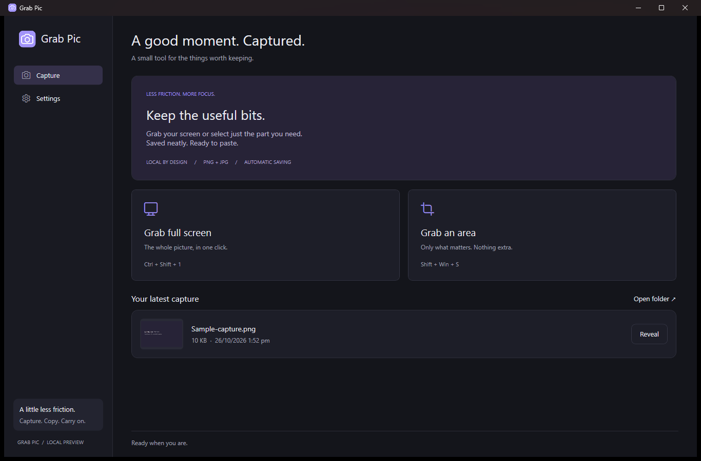
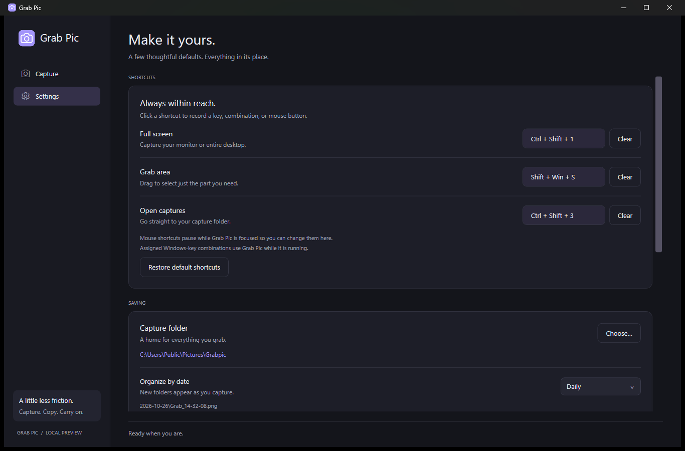
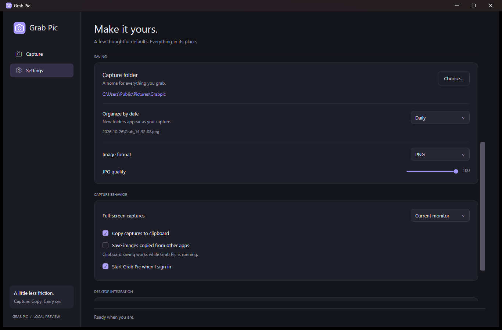

<p align="center"></p>

# Grabpic

New in 0.6.0: optional browser right-click capture for scrolling webpages, the visible webpage view, and area selection. Requires the separately enabled [browser companion](docs/BROWSERS.md); test packages are included with the submission bundle. Public browser-store publication is separate from the Windows Store app.

**Capture. Copy. Carry on.**

Grabpic is a free, open-source screenshot app for Windows. Grab your full screen or drag to select an area, get the image on your clipboard, and let Grabpic keep your captures neatly organized. It stays quietly in the system tray until you need it.

[Website](https://talhazahid.github.io/grabpic/) · [Privacy policy](https://talhazahid.github.io/grabpic/privacy/) · [Download for Windows](https://github.com/talhazahid/grabpic/releases/latest) · [Microsoft Store listing](https://apps.microsoft.com/detail/9PJ3HBXBCTX1) · [Report an issue](https://github.com/talhazahid/grabpic/issues) · [GPL-3.0 license](LICENSE)

The Store listing becomes downloadable after Microsoft approves and publishes the submission. Windows installer releases are available independently.



## Small tool, useful details

- **Full screen or just an area.** Capture the monitor under your pointer, all connected monitors, or a rectangle you choose.
- **Ready to paste.** Captures copy to the clipboard automatically by default and save to your chosen folder.
- **Neatly organized.** Group files into daily, ISO weekly, or monthly folders.
- **Your shortcuts.** Record a key, combination, or mouse button for Full Screen, Grab Area, and Open Captures. Windows-key combinations such as Win + Shift + S are supported.
- **Dark by default.** A calm interface with consistent controls and a slim scrollbar.
- **Quiet in the background.** Taking a screenshot does not open the app. Start with Windows and capture from the tray or desktop menu.
- **Pick up where you left off.** Open Grabpic to see the latest saved capture, even after restarting the app.
- **PNG or JPG.** PNG is lossless; JPG quality defaults to 100 and can be adjusted.
- **Local by design.** No account, uploads, ads, or analytics. Optional clipboard monitoring can save images copied from other apps.

## Get started

1. Download the latest `GrabPic-Setup-<version>-x64.exe` from [Releases](https://github.com/talhazahid/grabpic/releases/latest), or install from the Store once published.
2. Run setup. It adds the desktop menu and starts Grabpic in the tray. The standard installer requests administrator access to register its system-wide menu.
3. Use a capture shortcut, the tray menu, or right-click empty desktop space and choose **Grab Pic**. For the standard installer on Windows 11, use **Show more options**.
4. Paste the image wherever you need it. Your saved copy is already in the capture folder.

**Requirements:** Windows 11, Intel/AMD x64. The .NET runtime is included. ARM64 and 32-bit builds are not provided in this release.

### Default shortcuts

| Action | Default |
|---|---|
| Grab full screen | Ctrl + Shift + 1 |
| Grab area | Ctrl + Shift + 2 |
| Open captures | Ctrl + Shift + 3 |

Change any binding in **Settings → Shortcuts**. When you assign a Windows-key combination, Grabpic handles it while it is running; quitting or clearing the binding restores Windows' normal behavior. Windows security shortcuts, including Win + L and Ctrl + Alt + Delete, cannot be reassigned. Mouse bindings pause while the app is focused so you can still edit them.



## Saving and privacy

Choose a capture folder, date grouping, image format, and quality in Settings. Closing the window keeps Grabpic in the tray; use **Quit Grab Pic** to exit completely. Screenshots capture the currently visible desktop, not hidden virtual desktops.

Your captures and preferences stay on your computer. A cloud-synced folder can still be synchronized by its provider. Clipboard monitoring is off by default; when enabled, it saves image content locally while Grabpic is running. See the [privacy policy](https://talhazahid.github.io/grabpic/privacy/).



## Open source

Grabpic is released under the [GNU General Public License v3.0](LICENSE). You can study, modify, and share it under those terms. Contributions and [bug reports](https://github.com/talhazahid/grabpic/issues) are welcome.

ShareX was reviewed as research material during early development. Its source is not bundled or linked into this app. The application uses Windows capture APIs, WPF, and a small native shell extension for the Store package.

## Build it yourself

### Architecture and macOS handoff

The complete Windows application, native shell and browser-host code, browser extension, assets, packaging scripts, website, and QA tools are in this repository. Start with [CLAUDE.md](CLAUDE.md), the [architecture/source map](docs/ARCHITECTURE.md), and the [macOS porting guide](docs/MACOS-PORT.md). Repository rules are in [AGENTS.md](AGENTS.md).

The macOS guide covers feature parity, proposed native APIs, permissions, Retina/multiple displays, background lifecycle, browser integration, design tokens, and acceptance tests. There is no macOS implementation yet; the existing Windows executable and WPF UI cannot run natively on macOS. Add a native implementation under `macos/` while preserving the Windows app.

### Windows build

Install the .NET 8 SDK and use PowerShell on Windows:

```powershell
dotnet build src/GrabPic -c Release
dotnet run --project src/GrabPic
```

To regenerate icons and build the standalone installer, install Inno Setup 6.6 or later:

```powershell
powershell -ExecutionPolicy Bypass -File tools/Build-Setup.ps1
```

For the Microsoft Store package:

```powershell
powershell -ExecutionPolicy Bypass -File tools/Build-Store.ps1
```

The packaging script restores the pinned Microsoft SDK tools and a checksum-verified Zig C++ compiler. The manifest uses the registered `Geeklabs.GrabPic` identity. See [Store packaging](docs/STORE.md) and the [design system](DESIGN.md).

Run verification without opening the main UI:

```powershell
.\dist\GrabPic\GrabPic.exe --verify "$PWD\verification.txt"
```

Public screenshots are captured from the real app using an isolated profile and a generated sample image. They do not contain private desktop captures. The screenshots show an example custom area shortcut; fresh installs use the defaults listed above.

## Current scope

The current release focuses on still screenshots. Version 0.6.0 adds optional browser scrolling-page capture through the separately enabled companion extension; it does not include a general extension-free scrolling capture engine, image annotation, recording, or uploading. Browser extensions require their own publication/signing; see [browser setup and limits](docs/BROWSERS.md). Protected content may be unavailable, and HDR color accuracy needs wider validation. Store certification and availability are controlled by Microsoft. macOS is currently a documented porting plan, not a shipped build.
