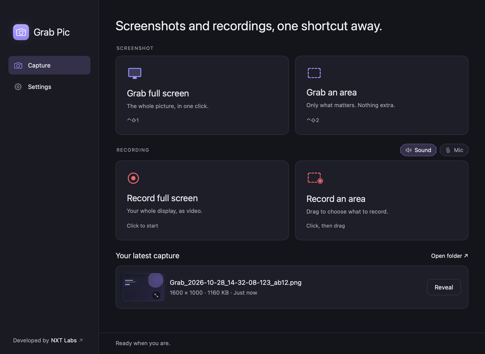
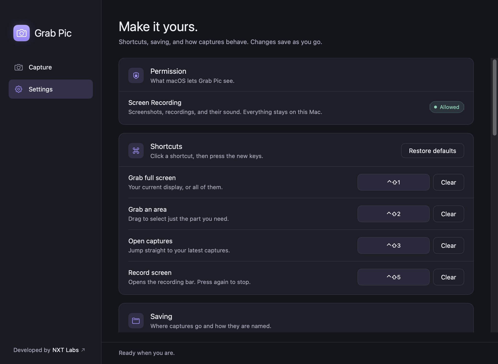
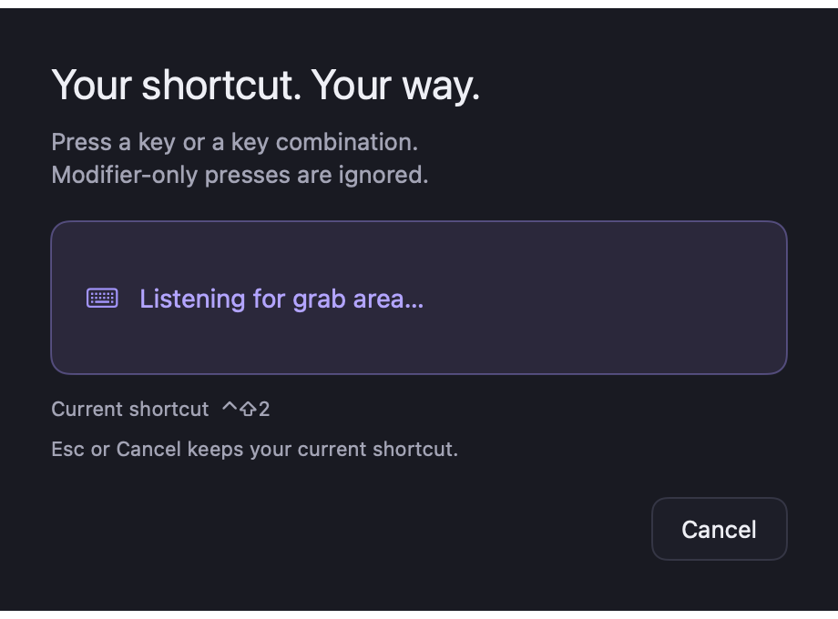

# Grab Pic for macOS

A native SwiftUI + AppKit port of Grab Pic for Apple silicon. It keeps the Windows app's
behaviour and visual system: capture without opening a window, save locally, copy to the
clipboard, and wait quietly in the menu bar.

This folder is an independent implementation. The Windows project is unchanged.



## Status

Working today, built and inspected on macOS 26.6.2 (arm64), Swift 6.4, deployment target macOS 14:

- Full-screen capture of the display under the pointer, or every display composed into one image.
- Frozen-screen area selection with crosshair, live pixel dimensions, Escape/right-click cancel,
  tiny-selection rejection, and exact pixel cropping.
- PNG or JPG output, JPG quality, daily/ISO-week/monthly folders, collision-resistant names,
  atomic writes, and a chosen capture folder.
- Automatic clipboard copy (on by default) and optional saving of images copied from other apps,
  with own-write suppression so Grab Pic never re-saves its own captures.
- An optional capture flash and the Mac's own camera shutter, both switchable in Settings. Feedback
  is cosmetic only and is never drawn into the saved image.
- Menu-bar-only operation: captures never open the main window; explicitly opening the app
  restores the latest saved capture. The menu bar icon can be hidden from Settings.
- "Open captures" opens the folder captures made now would use — today, this ISO week, or this
  month — and falls back to the capture root before the first capture of a period.
- Global keyboard shortcuts (Carbon hot keys), a shortcut recorder with conflict, reserved,
  modifier-only, and bare-key validation, plus persistence of cleared bindings.
- Login item through `SMAppService`, screen-recording state, and a path to System Settings.
- Dark, regular-weight interface built from the shared tokens in [DESIGN.md](../DESIGN.md).

Not in this build: the browser extension / native-messaging host, mouse-button shortcuts, Finder
integration, Developer ID signing, notarization, an installer, and the Mac App Store. See
[Known limits](#known-limits).





## Screen recording (0.7.0)

- **Record Screen** (⌃⇧5, menu bar, or the Capture page) records the display under the pointer; press
  again to stop. **Record Area** records a dragged region, outlined in red while recording (the outline
  is not in the video).
- Output is a web-ready MP4: H.264 High profile, AAC 48 kHz, BT.709 colour, even dimensions, and the
  movie header at the front (`shouldOptimizeForNetworkUse`) so browsers start playback immediately.
- Audio: system sound (on by default) and the microphone (optional) are mixed into one AAC track,
  so every player, browser, and chat app hears both.
- Options: full resolution (capped at 4K-class) or 1080p, 30 or 60 fps, pointer on or off.
- Files are saved as `Rec_<timestamp>_<id>.mp4` beside screenshots, written to a hidden `.part.mp4`
  first. Quitting while recording finishes the file before the app exits.

## Screen Recording permission after rebuilds

Builds are ad-hoc signed with a designated requirement pinned to `com.owl.grabpic`, so one approval
survives rebuilds. Approvals granted to builds made before 0.6.1 are tied to the old signature: macOS
shows the switch as on but refuses captures. Use **Repair** in Settings → Permission (it runs
`tccutil reset ScreenCapture com.owl.grabpic`), switch Grab Pic on again, and reopen it.

## Download and install

Download [Grabpic 0.7.0 for Apple silicon](https://github.com/talhazahid/grabpic/releases/tag/macos-v0.7.0), unzip it, and move `Grabpic.app` to Applications before enabling start at login. The ZIP includes a SHA-256 checksum in the release assets. This build is ad-hoc signed, without Developer ID signing or notarization. Gatekeeper may block opening; an explicit approval in System Settings → Privacy & Security may be needed for a trusted download. Grant Screen Recording permission and relaunch; microphone permission is required only for microphone audio.

The deployment target is macOS 14. Release QA was run on macOS 26.6.2, Apple silicon; minimum-version runtime compatibility and Intel Macs have not been verified.

## Requirements

- Apple silicon Mac running macOS 14 or later.
- Xcode 15+ (or the Command Line Tools) for the Swift toolchain and macOS SDK.
- No third-party dependencies.

## Build and run

```bash
cd macos
./scripts/build.sh
open build/Grabpic.app
```

`build.sh` finds a working `swiftc` and SDK, generates `Resources/Grabpic.icns` from the shared
camera geometry in `scripts/MakeIcon.swift`, compiles every source file under `Grabpic/`, and
ad-hoc signs the bundle. Set `SWIFTC`, `SDKROOT`, `TARGET`, or `GRABPIC_SIGN_IDENTITY` to override
the defaults; a real Developer ID and notarization are needed for a trusted Gatekeeper distribution.

The local build uses an ad-hoc signature with a bundle-identifier designated requirement. If Screen Recording permission stops working after a rebuild, use Repair in Settings and grant permission again.

Launch commands mirror the Windows words and are read at launch only:

```bash
build/Grabpic.app/Contents/MacOS/Grabpic --show        # open and restore the latest capture
build/Grabpic.app/Contents/MacOS/Grabpic --background  # menu bar only
build/Grabpic.app/Contents/MacOS/Grabpic --settings    # open Settings
build/Grabpic.app/Contents/MacOS/Grabpic --full        # capture now, no window
build/Grabpic.app/Contents/MacOS/Grabpic --area        # select an area, no window
build/Grabpic.app/Contents/MacOS/Grabpic --folder      # open the current period's capture folder
build/Grabpic.app/Contents/MacOS/Grabpic --quit
build/Grabpic.app/Contents/MacOS/Grabpic --startup     # enable start at login
build/Grabpic.app/Contents/MacOS/Grabpic --no-startup  # disable start at login
```

## First run

1. Open the app. Screen Recording is requested the first time you capture.
2. Approve Grab Pic in **System Settings → Privacy & Security → Screen Recording**, then relaunch.
   Settings shows the current state and can open the right pane.
3. Capture with the menu bar camera, the shortcuts below, or the two cards in the window.

| Action | Default |
|---|---|
| Grab full screen | ⌃⇧1 |
| Grab area | ⌃⇧2 |
| Open captures | ⌃⇧3 |

Shortcuts are stored as macOS key codes plus Carbon modifier masks, so they survive relaunches and
are independent of the Windows virtual-key model. Combinations macOS owns (⌘Space, ⌘Tab, ⇧⌘3/4/5,
and similar) and combinations already assigned inside Grab Pic are declined with an explanation.

## Lifecycle

- The bundle is `LSUIElement`, so it has no Dock icon while it is just a menu-bar utility.
- Showing the window switches the activation policy to `.regular` so the window behaves like a
  normal Mac app (Dock icon, ⌘-Tab, traffic lights).
- Closing the window hides it and returns to the menu bar; it does not quit.
- Captures hide the main window before asking ScreenCaptureKit for a frame, so Grab Pic never
  appears in its own screenshot.
- The menu bar camera uses the filled purple identity rather than a monochrome template glyph. That
  is deliberate, to keep the mark consistent with the app, Dock, and Windows tray icon.

## Architecture

```text
macos/
  Grabpic/
    App/         AppDelegate, launch commands, window controller, status icon, AppState
    Capture/     ScreenCaptureKit capture, display frames, area overlay, composition, feedback
    Input/       Carbon hot keys, SMAppService login item
    Model/       preferences, capture actions, shortcut bindings and validation
    Storage/     PNG/JPG encoding, naming, date folders, clipboard
    UI/          Root, Capture, Settings, Preview, recorder, shared components, tokens
  QA/            offline preview renderer, permission-free logic checks, window/sound probe
  Resources/     Info.plist and the generated .icns
  scripts/       build, preview rendering, logic tests
```

`AppState` owns the flow: capture → compose → save off the main actor → clipboard → latest capture
→ status. Capture and encoding never run on the main thread; views only observe published state.
Capture feedback runs after the frame is delivered and the image is composed, so the flash can never
appear in a saved capture; the app's own windows are excluded from ScreenCaptureKit regardless.

Coordinate rules: `DisplayShot.frame` is in AppKit global points (bottom-left origin), while image
rows start at the top of each display. Cropping converts both explicitly, derives density from the
delivered image, and composes mixed-scale displays at the highest density involved, filling gaps
between displays with the canvas colour. Capture requests the backing-store resolution so scaled
Retina modes stay crisp instead of silently saving at point size.

## Testing

Two scripts run without the owner's desktop:

```bash
cd macos
./scripts/run-logic-tests.sh   # 54 checks: naming, folders, encoding, crop orientation,
                               # cross-display composition, gap fill, shortcut validation,
                               # persistence, open-captures targets
./scripts/render-previews.sh   # renders real views with generated content into build/previews/
```

`QA/WindowProbe.swift` is a small helper for the parts of feedback that live outside the model. It
samples the window server for a process's windows (bounds, level, opacity — no pixels, no extra
permission) or plays the system shutter and reports the result:

```bash
swiftc -swift-version 5 -O -sdk "$(xcrun --show-sdk-path)" -target arm64-apple-macos14.0 \
    QA/WindowProbe.swift -o build/WindowProbe
build/WindowProbe grab 7    # watch for 7 seconds while a capture runs
build/WindowProbe --sound
```

Verified for this build:

- `run-logic-tests.sh` reports 54 of 54 checks passing, including top-left crop orientation,
  negative-origin multi-display composition, gap filling, ISO-week folder names, file signatures,
  cleared-shortcut persistence, preference round-tripping for the flash, shutter, and menu bar
  switches, and the day/week/month folder "Open captures" targets.
- A real full-screen capture through the launch command saved a 3420 × 2214 PNG at native 2× for a
  1710 × 1107 points display, into a disposable profile, without opening the main window.
- The window probe recorded that capture's flash overlay: a full-display 1710 × 1107 window at 0,0 on
  level 1000, opacity ramping 0 → 1 → 0 in about 0.29 s, with the 20% warm-white fill kept subtle.
  With `"flash": false` and `"shutter": false` in the same profile no overlay window appeared and the
  capture still saved.
- The probe loaded the system shutter (`/System/Library/Components/CoreAudio.component/Contents/
  SharedSupport/SystemSounds/system/Shutter.aif`, 0.49 s) and reported playback starting. Audibility
  depends on the Mac's output device and volume; nothing is bundled or downloaded.
- Start at login registers through `SMAppService`: `sfltool dumpbtm` lists Grabpic as an enabled
  app item at the bundle path it was enabled from. Registration was exercised with `--startup` from
  `~/Downloads`, then repointed to that copy.
- Menu bar visibility was checked in pixels: with the switch on, the purple camera sits in the status
  area; with `"menuBarIcon": false`, the strip renders without it.
- Launching with `--show` restored that folder's newest capture in the latest-capture card.
- The menu-bar camera, the window chrome, and the five rendered screens are from the built bundle
  and real UI sources.

Not verified interactively: hearing or watching the feedback by hand, the area-capture path's
feedback (it needs a real drag), clicking the menu-bar menu, keyboard focus rings, area dragging,
clicking the custom switches in the running window (this harness cannot post mouse clicks, so their
state was checked through the preference file and the rendered views), an actual sign-in launch,
the login-item approval prompt, permission denial/revocation, multiple physical displays, mixed
display scales, HDR/wide-gamut content, and clipboard monitoring with real external apps. Automating
those needs Accessibility permission for the test harness, which this workspace does not have. The
screenshots in `docs/screenshots/` use generated content only.

## Known limits

- **Browser capture is absent.** No native-messaging host, manifest installer, or extension flow is
  implemented. The Windows browser feature is untouched in `browser-extension/`.
- **Keyboard shortcuts only.** Mouse-button bindings are not supported; the recorder rejects
  modifier-only and bare-key attempts instead of registering something surprising.
- **One display tested.** Cross-display composition and negative origins are covered by logic
  tests, not by physical hardware in this pass.
- **Unsigned distribution limits.** A ZIP is provided; no Developer ID, notarization, DMG, or App Store sandbox setup;
  the bundle is ad-hoc signed for local use. Screen Recording may need re-approval after rebuilds.
- **Launch arguments only.** `--settings`, `--full`, and friends are read when the process starts.
  There is no IPC channel to forward a command to an already-running instance; Windows uses a named
  pipe for this.
- **Login launch is best-effort.** The app checks the open-application event's login flag. If macOS
  omits it, the window may open at login instead of staying in the menu bar. The login item is tied
  to the bundle path it was enabled from, so move the app first and then turn start at login on.
- **Hidden menu bar icon.** With the icon hidden, the window and shortcuts are the only way in; the
  app keeps running after the window closes. Reopening it from Finder shows the window again.
- **SDR assumed.** No HDR/wide-gamut tone mapping or colour-space tagging work has been done.
- **Feedback is system-dependent.** The flash covers the whole captured display rather than the
  selected area, and the shutter reads a system sound file at a fixed path. If a future macOS moves
  it, Grab Pic falls back to the screen-capture click and then the system "Tink" alert.
- **No annotation editor, scrolling capture, OCR, or cloud features.** Screen and area recording are Mac-specific additions in 0.7.0.

## Privacy

No account, network calls, ads, analytics, or upload service. Captures, clipboard images, and
preferences stay on the Mac: images in the chosen folder, preferences in
`~/Library/Application Support/Grabpic/settings.json`. Set `GRABPIC_PROFILE_DIRECTORY` to use a
disposable profile during testing. Clipboard monitoring is off by default.

## License

Grab Pic is free software under the [GNU General Public License v3.0](../LICENSE). The camera
geometry and colour identity are shared with the Windows assets in `src/GrabPic/Assets/`.
